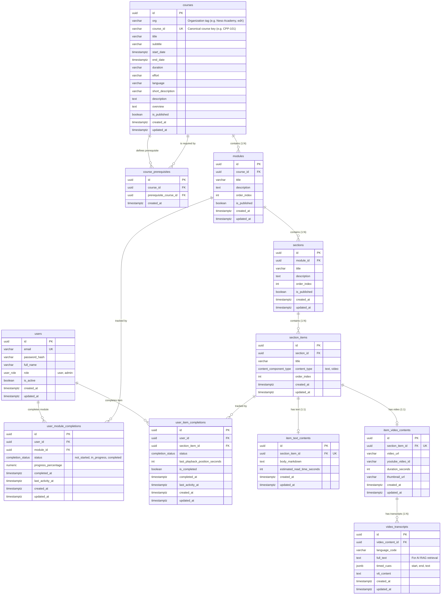

# LMS Database Schema Reference & Architecture Guide

This document provides a comprehensive overview of the PostgreSQL relational database schema designed for this Learning Management System (LMS). It is intended for software engineers, data engineers, and AI developers building features or backend services on top of this database.

---

## 1. High-Level Architecture

The schema follows a **Course-First** structural model inspired by Open edX (Course -> Module/Chapter -> Section/Subsection -> Unit Items). It is engineered for:
1. **Self-Curated Content**: The catalog is directly authored and curated without multi-tier instructor creation overhead.
2. **Interactive AI Readiness**: Video transcripts feature timed cues (`JSONB`) and full continuous text indexed with PostgreSQL `GIN` full-text search, enabling AI assistants, retrieval-augmented generation (RAG), and video seek jumping.
3. **Frictionless Learning**: No registration/enrollment gates are required. Any registered learner can immediately access courseware and record module/item progress.

---

## 2. Entity Relationship Diagram



---

## 3. Database Table Definitions

### 3.1 `users`
Stores user identities and authentication information.
- **`id`** (`UUID`, PK): Auto-generated unique identifier (`gen_random_uuid()`).
- **`email`** (`VARCHAR(255)`, Unique): User login email.
- **`password_hash`** (`VARCHAR(255)`): Securely hashed password.
- **`full_name`** (`VARCHAR(150)`): Learner or administrator display name.
- **`role`** (`ENUM: 'user', 'admin'`): Access control tier.
- **`is_active`** (`BOOLEAN`): Account activity toggle.

### 3.2 `courses`
Core educational offering catalog holding high-level metadata.
- **`id`** (`UUID`, PK): Primary key.
- **`org`** (`VARCHAR(100)`): Institution or author code (e.g., `'Neso Academy'`, `'edX'`).
- **`course_id`** (`VARCHAR(100)`, Unique): Canonical course code (e.g., `'CPP-101'`, `'ML-201'`).
- **`title`** (`VARCHAR(255)`): Official course title.
- **`subtitle`** (`VARCHAR(500)`): Secondary headline or course tagline.
- **`start_date` / `end_date`** (`TIMESTAMPTZ`): Course duration window (null for self-paced courses).
- **`duration`** (`VARCHAR(100)`): Estimated timeline (e.g., `'8 weeks'`).
- **`effort`** (`VARCHAR(100)`): Weekly time commitment (e.g., `'4-6 hours per week'`).
- **`language`** (`VARCHAR(50)`): Primary instruction language (default: `'en'`).
- **`short_description`** (`VARCHAR(1000)`): Brief summary for cards and search listings.
- **`description`** (`TEXT`): Comprehensive course curriculum overview.
- **`overview`** (`TEXT`): High-level background and learning objectives.
- **`is_published`** (`BOOLEAN`): Controls visibility on student dashboards.

### 3.3 `course_prerequisites`
Normalized self-referential junction table enforcing valid prerequisite trees between courses.
- **`id`** (`UUID`, PK): Primary key.
- **`course_id`** (`UUID`, FK): References `courses(id)` (the course requiring prerequisites).
- **`prerequisite_course_id`** (`UUID`, FK): References `courses(id)` (the required foundation course).
- **Constraints**:
  - `uq_course_prerequisite UNIQUE (course_id, prerequisite_course_id)`: Prevents duplicate links.
  - `chk_no_self_prerequisite CHECK (course_id <> prerequisite_course_id)`: Prevents self-dependency.

### 3.4 `modules`
Thematic chapters grouping learning topics within a course (e.g., "Module 1: C++ Operators").
- **`id`** (`UUID`, PK): Primary key.
- **`course_id`** (`UUID`, FK): Parent course ID (`ON DELETE CASCADE`).
- **`title`** (`VARCHAR(255)`): Module title.
- **`description`** (`TEXT`): Thematic overview.
- **`order_index`** (`INTEGER`): Ordering position (0, 1, 2...).
- **Constraints**: `uq_course_module_order UNIQUE (course_id, order_index)` guarantees sequential consistency.

### 3.5 `sections`
Sub-units inside a module (e.g., "Section 1.1: Arithmetic & Relational Operators").
- **`id`** (`UUID`, PK): Primary key.
- **`module_id`** (`UUID`, FK): Parent module ID (`ON DELETE CASCADE`).
- **`title`** (`VARCHAR(255)`): Subsection title.
- **`description`** (`TEXT`): Topic description.
- **`order_index`** (`INTEGER`): Ordering position inside the module.
- **Constraints**: `uq_module_section_order UNIQUE (module_id, order_index)`.

### 3.6 `section_items`
Polymorphic container that sequences concrete learning components (videos, articles, quizzes) within a section.
- **`id`** (`UUID`, PK): Primary key.
- **`section_id`** (`UUID`, FK): Parent section ID (`ON DELETE CASCADE`).
- **`title`** (`VARCHAR(255)`): Component title.
- **`content_type`** (`ENUM: 'text', 'video'`): Distinguishes the subtype table to join.
- **`order_index`** (`INTEGER`): Display position within the section.
- **Constraints**: `uq_section_item_order UNIQUE (section_id, order_index)`.

### 3.7 `item_video_contents`
1-to-1 extension table for YouTube video components.
- **`id`** (`UUID`, PK): Primary key.
- **`section_item_id`** (`UUID`, FK, Unique): References `section_items(id)` (`ON DELETE CASCADE`).
- **`video_url`** (`VARCHAR(1000)`): Full YouTube or streaming URL.
- **`youtube_video_id`** (`VARCHAR(64)`): Extracted 11-character YouTube video ID (e.g., `'1XbtijPZKUs'`) for direct client-side YouTube iFrame API player controls.
- **`duration_seconds`** (`INTEGER`): Video length in seconds.
- **`thumbnail_url`** (`VARCHAR(1000)`): Optional preview image.

### 3.8 `video_transcripts`
1-to-many subtitle and continuous dialogue table designed for AI interaction and video sync.
- **`id`** (`UUID`, PK): Primary key.
- **`video_content_id`** (`UUID`, FK): References `item_video_contents(id)` (`ON DELETE CASCADE`).
- **`language_code`** (`VARCHAR(10)`): ISO language code (e.g., `'en'`).
- **`full_text`** (`TEXT`): Continuous, un-timestamped transcript. Indexed with a PostgreSQL `GIN` index (`to_tsvector('english', full_text)`) for fast full-text search.
- **`timed_cues`** (`JSONB`): Array of timestamped speech cues with floating-point second markers:
  ```json
  [
    {"start": 0.0, "end": 5.0, "text": "Hello everyone, welcome to Neso Academy..."},
    {"start": 5.0, "end": 11.0, "text": "In this lecture, we examine operators..."}
  ]
  ```
- **`vtt_content`** (`TEXT`): Standard WebVTT string for native HTML5 video subtitles.
- **Constraints**: `uq_video_language UNIQUE (video_content_id, language_code)`.

### 3.9 `item_text_contents`
1-to-1 extension table for reading materials, study guides, and article summaries.
- **`id`** (`UUID`, PK): Primary key.
- **`section_item_id`** (`UUID`, FK, Unique): References `section_items(id)` (`ON DELETE CASCADE`).
- **`body_markdown`** (`TEXT`): Full Markdown formatted notes, syntax summaries, official reference URLs, and self-assessment questions.
- **`estimated_read_time_seconds`** (`INTEGER`): Calculated reading duration based on word count.

### 3.10 `user_module_completions`
User-wise completion tracking table per module.
- **`id`** (`UUID`, PK): Primary key.
- **`user_id`** (`UUID`, FK): References `users(id)` (`ON DELETE CASCADE`).
- **`module_id`** (`UUID`, FK): References `modules(id)` (`ON DELETE CASCADE`).
- **`status`** (`ENUM: 'not_started', 'in_progress', 'completed'`): Current status.
- **`progress_percentage`** (`NUMERIC(5,2)`): Progress metric from `0.00` to `100.00`.
- **`completed_at`** (`TIMESTAMPTZ`): Timestamp when module was completed.
- **Constraints**: `uq_user_module UNIQUE (user_id, module_id)` ensures idempotent tracking.

### 3.11 `user_item_completions`
Granular interaction record tracking video playback resume points and reading marks.
- **`id`** (`UUID`, PK): Primary key.
- **`user_id`** (`UUID`, FK): References `users(id)` (`ON DELETE CASCADE`).
- **`section_item_id`** (`UUID`, FK): References `section_items(id)` (`ON DELETE CASCADE`).
- **`status`** (`ENUM: 'not_started', 'in_progress', 'completed'`): Component status.
- **`last_playback_position_seconds`** (`INTEGER`): Video playback timestamp (in seconds) to resume playback where the user left off.
- **`is_completed`** (`BOOLEAN`): Generated column automatically evaluating `(status = 'completed')`.
- **Constraints**: `uq_user_section_item UNIQUE (user_id, section_item_id)`.

---

## 4. How to Initialize & Seed

To spin up the database and apply the schema and data from scratch:

```bash
# 1. Start clean PostgreSQL container
docker compose up -d

# 2. Run the initialization script
python3 scripts/init_and_seed.py
```

The script parses [data/LMSxAI.xlsx](file:///home/sudhanshu/Desktop/LMS-AI/data/LMSxAI.xlsx) and [data/Transcript_data](file:///home/sudhanshu/Desktop/LMS-AI/data/Transcript_data), executes the DDL, and populates all 5 courses, 24 lectures, and transcripts into the running container.
